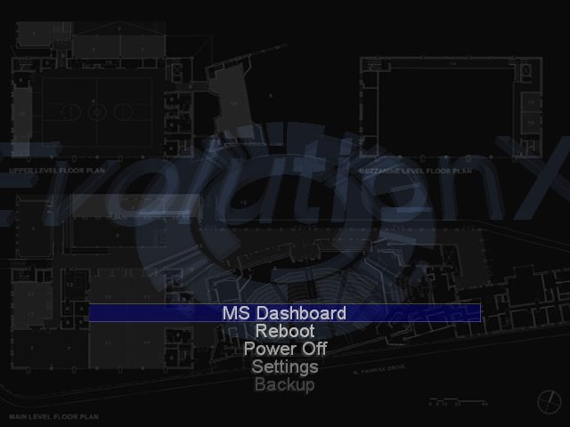

# RXDK EvolutionX

<p align="center"><b>The EvolutionX dashboard (build 3935) rebuilt as C++ source on the open RXDK SDK</b></p>

<p align="center">
  <a href="https://github.com/Team-Resurgent/RXDK-EvolutionX/actions/workflows/build.yml"></a>
  <a href="https://discord.gg/VcdSfajQGK"></a>
</p>

<p align="center">
  <a href="https://ko-fi.com/J3J7L5UMN"></a>
  <a href="https://www.patreon.com/teamresurgent"></a>
</p>

<p align="center">
  <a href="https://github.com/Team-Resurgent/RXDK-EvolutionX/releases/latest"></a>
</p>

<p align="center">
  
</p>

## About

EvolutionX is the classic Xbox dashboard: the skinnable menu with its `[Menu]` in evox.ini, the
Settings / Info screen, launching games and apps with trainers and the in-game reset, BIOS
flashing, Backup, scripted `[Action_NN]` items, and the FTP, Telnet and RDTOOLS debug servers.
This project reconstructs build 3935 function by function as C++, and builds it on the RXDK SDK
libraries (D3D8, D3DX8, XGraphics, XNet, XAPI, the C runtime) instead of the XDK ones the original
carried. EvoX's own code is all rebuilt.

Only what EvoX carried ready-made inside its XBE is taken from the original: its built-in
graphics (two XPR texture packs and the XBG logo mesh), and the in-game reset's loader and two
TSRs. They are in `assets/`, cut unchanged from build 3935, so the build needs nothing else.

In xemu the start screen matches the original's pixel for pixel outside the turning logo, every
skin variable reads the same, and the FTP, Telnet and debug servers give the same transcripts.

## Changes from the original

None in behaviour are intended. How it is built differs:

- **Not packed:** the original `evoxdash.xbe` is a loader stub around a raw-DEFLATE XBE; the
  rebuilt XBE is plain.
- **Crash guards:** EvoX's 31 `catch (...)` blocks (around evox.ini's lock, the servers' threads,
  skin loading, start-up) caught crashes as well as C++ exceptions with the original's compiler,
  so a fault there was logged or skipped and the dashboard kept running. RXDK's clang has no
  `__try` / `__except` on its target, so `include/evox/guard.h` registers an exception frame of its
  own for each of them.
- **XNet link status:** the SDK's `XNetGetEthernetLinkStatus` can report speed bits without a link;
  EvoX's checks see it as the XDK reported it (`EthernetLinkStatus` in `include/evox/netcfg.h`).

## Requirements

Windows, Linux or macOS, with:

- **RXDK** (clang, the SDK, `Rxdk.Cli` and `imagebld`) where RXDK installs itself:

  | OS | RXDK root |
  |---|---|
  | Windows | `%ProgramData%\RXDK` |
  | macOS | `~/Library/Application Support/RXDK` |
  | Linux | `$XDG_DATA_HOME/rxdk` (`~/.local/share/rxdk`) |

  Set `RXDK` to use another root. The RXDK VS Code / Visual Studio setup installs it, or run
  `pwsh scripts/stage-rxdk.ps1`, which downloads and lays it out as CI does.
- **Bash** (Git Bash on Windows)

## Build

```bash
./build.sh
```

| Output | What |
|---|---|
| `out/evoxdash.xbe` | EvolutionX, with the original's title id (0x586F7645 "RemoteX"), certificate, init flags and 64 KB stack |

Every push to `main` builds on GitHub Actions and publishes the XBE as the rolling `latest`
release; a `v*` tag makes a fixed release. `RX_OUT=<dir>` builds somewhere else; `EXTRA_CFLAGS`
adds defines, e.g. `EXTRA_CFLAGS=-DEVOX_UART_LOG ./build.sh`.

| Switch | Does |
|---|---|
| `EVOX_UART_LOG` | the debug log also goes to the COM1 UART (xemu `-device lpc47m157 -serial stdio`) |

## Source layout

| Files | What |
|---|---|
| `src/main.cpp`, `launch.cpp`, `globals.cpp` | start-up, evox.ini settings, network start-up, leaving the dashboard |
| `src/dash.cpp`, `dash_run.cpp`, `dash_draw.cpp` | the dashboard object, the frame loop with its action and fade states, drawing |
| `src/dash_skin.cpp`, `skinvars.cpp`, `dash_menus.cpp`, `menu.cpp` | skins and their text labels and variables, the built-in menu, folder scans and `[Menu]` |
| `src/settings.cpp`, `trainer.cpp`, `actions.cpp`, `flash.cpp`, `backup.cpp` | the Settings / Info screen and keyboards, trainers, `[Action_NN]`, the Flash BIOS box and writer, Backup |
| `src/info.cpp`, `clock.cpp`, `cdaudio.cpp`, `chameleon.cpp`, `devices.cpp` | the live information, the SNTP clock, audio CDs, the Chameleon LED, the DVD remote and USB keyboard |
| `src/hdd.cpp`, `igr.cpp` | drive letters, IDENTIFY, SMART and the lock password; the in-game reset install |
| `src/ftp.cpp`, `ftp_session.cpp`, `telnet.cpp`, `telnet_cmds.cpp`, `debugserver.cpp`, `socket.cpp`, `netcfg.cpp` | the FTP, Telnet and RDTOOLS debug servers, sockets, the network config |
| `src/inifile.cpp`, `log.cpp`, `md5.cpp`, `guard.cpp` | evox.ini reader / writer, the debug log, MD5, the crash guard |
| `src/xbfont.cpp`, `xbmesh.cpp`, `xbresource.cpp`, `xbinput.cpp`, `xbutil.cpp` | the XDK sample-framework classes EvoX built in |
| `include/evox` | one header per module |
| `assets` | the graphics and in-game reset code from the original, and `assets.S`, which links them |

The comment on each function and global gives its address in the original 3935 image.

## Credits

EvolutionX is the work of Team EvoX. This project only reconstructs build 3935 to build it on an
open SDK.
